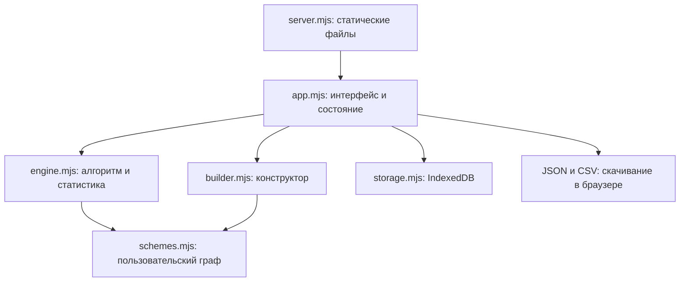

# Архитектура

## Границы

Приложение работает в браузере. Node раздаёт HTML, CSS и ESM-модули.
Сохранение выполняется через IndexedDB; сервер не получает журнал и изображения.
Нет сетевого API записи, аккаунтов, получения котировок или исполнения сделок.

## Карта модулей

| Файл | Ответственность |
| --- | --- |
| `index.html` | Точка монтирования, toast, диалог изображений, файловый input импорта |
| `styles.css` | Общие стили, журнал, редактор и адаптивная вёрстка |
| `app.mjs` | Состояние, рендер, события, автосохранение, журнал, статистика, импорт/экспорт |
| `engine.mjs` | Встроенные вопросы/переходы, адаптеры, сессии, итог, расчёты, проверка импорта, CSV |
| `schemes.mjs` | Создание схем/блоков, проверка графа, выполнение пользовательского пути |
| `builder.mjs` | Библиотека, редактор, выбор блока, автоматическая SVG-карта |
| `scheme-map.mjs` | Раскладка по переходам, упорядоченные порты и SVG соединений |
| `hint-images.mjs` | Проверка MIME/base64/размера и чтение файла подсказки |
| `image-drop.mjs` | Делегированные drag/drop-события, проверка файлов и подсветка зон |
| `examples.mjs` | Сохраняемая видимость встроенных примеров, удаление и восстановление |
| `journal.mjs` | Удаление по ID, очередь, защита от позднего сохранения и выбор currentId |
| `storage.mjs` | Открытие IndexedDB и транзакции object stores |
| `server.mjs` | Loopback HTTP, allowlist ресурсов, CSP и `/health` |
| `Start.cmd`, `Start.ps1`, `Stop.ps1` | Фоновый запуск/остановка на Windows |
| `tests/*.test.mjs` | Проверки чистой логики и обработчика удаления |

## Встроенный и пользовательский маршруты

Встроенный маршрут описан в `engine.mjs`: `question`, `route`, `answer`, `evaluation`,
`scenario`. Функция `next` задаёт переходы. Вопросы меняются в зависимости от локального направления.
Две встроенные SVG в разделе «Примеры» вручную отражают этот алгоритм.
Их удаление меняет только видимость примеров. `createExampleVisibility` сохраняет список
скрытых ID до изменения UI и сериализует одновременные действия. Ошибка записи сохраняет
прежнюю видимость. Собственные схемы и исполнитель алгоритма от этого не меняются.

Пользовательский маршрут исполняется по `schemeSnapshot` функциями `customRoute`,
`customAnswer`, `customEvaluation` из `schemes.mjs`. Вход — `startId`, выбранный ответ
ссылается на `next`, путь завершается блоком `result`.

Общий UI использует `routeFor(session)`, `answerFor(session, key, value)`,
`evaluationFor(session)`, `scenarioFor(session)`: наличие `schemeSnapshot` выбирает реализацию.
Прямой вызов `route(session.answers)` для пользовательского разбора неверен.

## Жизненный цикл разбора

1. `freshSession()` создаёт встроенный разбор. `freshSchemeSession(scheme)` проверяет
   схему и глубоко копирует её в разбор.
2. Ответ обновляет `answers`. Если изменён ранний вопрос, последующие ответы отбрасываются.
3. `answerAndAdvance` выбирает ответ и задаёт `cursor = index + 1`: UI сразу открывает следующий
   вопрос или итог. Повтор того же ответа сохраняет последующий путь, изменение отсекает его.
   `routeFor` возвращает посещённые вопросы и следующий неотвеченный либо итог.
4. Пользователь фиксирует сделку или наблюдение без входа.
5. `lockDecision` сохраняет `decisionSnapshot`: ответы, версию, заключение и время фиксации.
6. UI блокирует вопросы, сохраняя возможность добавить фактический исход и комментарии.

Неизменяемость решения — контракт функций/UI. Объекты не защищены через `Object.freeze`
или ограничения IndexedDB; новый код должен соблюдать этот контракт.

UI обрабатывает click на label ответа с preventDefault, чтобы не получить второе событие
от связанного radio. Это позволяет повторить выбранный ответ после «Назад». Native change
поддерживает выбор с клавиатуры. Оба пути вызывают `selectAnswer`; устаревшие события от другого
шага игнорируются. После перерисовки фокус переходит на заголовок, карточка прокручивается к началу.
Кнопка «Назад» остаётся; итог не фиксирует решение автоматически.
Поля зоны встроенного алгоритма расположены перед ответами, чтобы их можно было заполнить до перехода.

## Контекстные и общие схемы

`scheme.group` различает `context` и `shared`. `schemeGroup` возвращает context для старых
объектов без этого поля, не меняя их. Группа отвечает за организацию библиотеки,
не меняет локальный граф, исполнение или готовность. Смена группы — обычная правка версии;
ID схемы и ссылки на неё сохраняются. `newSharedScheme` создаёт пустой черновик без блоков.

`createBuilder` сочетает фильтр группы с фильтром статуса. В селекторе назначения общие
и контекстные схемы находятся в optgroup; черновики недоступны для выбора.
`schemesUsing` находит все исходные схемы, ссылающиеся из result на указанный ID,
считая каждую исходную схему один раз. Редактор показывает их ссылки. Перед переходом
в редактор другой схемы сохраняется текущая. Удаление предупреждает о затронутых ссылках.

Переиспользование основано на существующем nextSchemeId, без копирования блоков и новых stores.
При прохождении общей схемы inheritedContext показывает исходные вопросы/ответы из previous.
Это справочный текст, без автоматического присваивания переменных или переключения веток.
Группа включается в снимок схемы и общий JSON. Старые снимки не меняются при классификации библиотеки.

## Переходы между схемами в одном разборе

`scheme-flow.mjs`: `schemeTransitionInfo` разрешает назначение, `transitionToScheme`
начинает/возобновляет этап, `returnToScheme` возвращает к предыдущему итогу,
`assertSchemeTrail` проверяет архив.

`result.nextSchemeId` ссылается на другую схему библиотеки. Это ручной переход кнопкой,
а не ребро локального графа. Первое посещение требует готового назначения и копирует его.
Проверка исходного графа не требует наличия назначения в библиотеке.

Активный этап остаётся в прежних полях session. `schemeTrail.previous` хранит пройденные
этапы; `next` — сохранённое продолжение после возврата. Возврат активирует глубокую копию
прежнего этапа на его итоговом экране. Повторный переход использует сохранённый `next[0]`,
даже после правок/удаления библиотеки. Изменённый ответ очищает `next`, неизменённый сохраняет.
Идентификатор записи, заметки, скриншоты и trade остаются общими.

`navigateScheme` ждёт сохранения, проверяет текущую запись/итог и подавляет повторный
переход до завершения. `runScheme` здесь не используется: он создаёт новую запись.
История показывает версии и ответы; после `lockDecision` переходы и возврат заблокированы.
Снимок решения содержит `schemePath` всей цепочки. Неиспользованное будущее удаляется
при фиксации. Статистика считает одну сделку по активной, то есть последней, схеме.
Карта показывает название внешнего назначения, не объединяя графы.

## Состояние и сохранение

`app.mjs` хранит в памяти `sessions`, `customSchemes`, `currentId`, `cursor`, раздел,
поиск и фильтр. Навигация использует hash: `#new`, `#journal`, `#stats`, `#schemes`, `#builder`.
Текущий `currentId` сохраняется; поиск и фильтры — только в памяти страницы.
Выбранный блок сохраняется в `scheme.editorNodeId` и восстанавливается при открытии схемы.

`put(session)` обновляет память и очередь `pending` по ID, сохраняя копию объекта.
`putScheme` обновляет библиотеку и помечает её для записи целиком.
После 250 мс без нового изменения вызывается `flush()`. Promise-цепочка сериализует операции.
Явное сохранение и переходы также вызывают `flush`; при скрытии страницы используется `visibilitychange`.
Ошибка показывает уведомление и оставляет данные в памяти для экспорта.

Одна storage-операция использует транзакцию IndexedDB. Весь импорт или пачка сохранений
не являются одной общей транзакцией. Форматы и восстановление — в [DATA.md](DATA.md).

## Удаление записей журнала

`createJournalDeletion` в `journal.mjs` удаляет по ID выбранной строки, независимо от открытого
разбора. HTML-диалог показывает данные записи; отмена не меняет состояние.
После подтверждения контроллер блокирует новые `put` этого ID, ждёт `flush` и вызывает
`repository.removeRecord(id, nextCurrentId)`. Удаление из `sessions` и запись `meta.currentId`
выполняются одной транзакцией. Только после успеха запись удаляется из памяти и статистики.
Ошибка сохраняет строку и разрешает повторную попытку. Повторные запросы одного ID подавляются,
удаления разных ID сериализуются. Явный импорт снимает блокировку позднего автосохранения.

`selectCurrentRecordId` оставляет существующий выбор либо выбирает самый новый разбор.
При пустом журнале сохраняется `null`; загрузка и раздел «Разбор» не создают черновик
автоматически. Новая запись требует явного начала разбора или запуска схемы.

## Конструктор и версии

`createBuilder` получает из `app.mjs` функции работы с библиотекой, сохранения, удаления,
запуска, рендера, уведомлений и экранирования. Собственного соединения с IndexedDB у него нет.
Текстовые изменения обновляют модель и карту без полной перерисовки поля ввода;
структурные изменения и выбор перехода перерисовывают редактор.

`inspectScheme` отделяет блокирующие ошибки от предупреждений о недостижимых блоках.
Проверка достижимых циклов не использует рекурсию. Карта размещает блоки автоматически;
нажатие выбирает блок, ручного перетаскивания координат нет.
Порядок элементов `nodes` не задаёт порядок вопросов — его задают ссылки `next`.

`layoutSchemeMap` обходит граф в порядке вариантов ответа, назначает слои по самому длинному
пути и упорядочивает дочерние блоки по выходам родителей. Выходы/входы стрелок сортируются
по фактическому расположению соседей, что убирает перекрещивание на простой развилке.
Соединения прямоугольные; длинные и обратные переходы обходят блоки по внешним дорожкам.
Названия блоков и подписи переходов показываются целиком, без ограничения числа строк и многоточий.
`wrapMapText` переносит по словам, сохраняет ручные переводы строк и разбивает только слишком
длинные слова (по возможности после дефиса). В браузере ширина измеряется canvas в том же
шрифте, что у SVG; чистая раскладка принимает измеритель, для Node предусмотрена консервативная
оценка. Высота блока, подложки подписи и промежуток между рядами зависят от всех строк.
Подписи находятся у своих выходов, повороты линий проходят ниже текста.
Общие назначения сохраняются одним блоком. Для произвольного связного графа полное отсутствие
пересечений не гарантируется; циклы черновиков отображаются, но по-прежнему блокируют запуск.
Функции раскладки и рендера не меняют схему, ответы, revision или хранилище.

У библиотеки есть явный `status`: `draft` или `ready`. `schemeStatus` обеспечивает совместимость
с прежними схемами без этого поля. Новые схемы и копии начинают как черновики; правки готовой
схемы возвращают статус `draft`. Проверка валидности сама по себе не делает схему готовой.
`Сохранить черновик` сохраняет даже незаполненный граф и ждёт успешного `persist`/`flush`
перед возвратом в список. `Сохранить готовую` и запуск требуют корректного графа.
`createBuilder` получает callback `persist` из приложения, а не пишет в IndexedDB самостоятельно.

При открытии существующей схемы готовится `revision + 1` для первой правки. Несколько
правок в том же сеансе редактора используют одну версию. Новая схема сохраняет revision 1;
после запуска следующий набор правок получает новую версию. Это не hash содержимого
и не полная история изменений библиотеки.

## Скриншоты подсказок и ответов

Вопрос хранит галерею `hintImages`, вариант ответа — `exampleImages`.
Каждый элемент: `{id, name, data}`, до 10 файлов PNG/JPEG/WebP/GIF по 5 МиБ.
`assertImageGallery` проверяет изображения и уникальные безопасные ID.
`imageGallery` читает массив либо прежнее одиночное поле `hintImage` / `exampleImage`;
для одиночного файла используется временный ID `legacy`. Пустой массив имеет приоритет.
Чтение старых объектов не меняет данные. При первой правке галереи `setImageGallery`
записывает массив и удаляет старое поле. Снимки и JSON сохраняют оба формата без миграции БД.

Редактор вызывает `attachHintImages` / `attachAnswerImages`. До чтения захватываются ID
схемы/вопроса/ответа; сначала проверяются все файлы пачки. Чтение идёт параллельно, фиксация
добавлений сериализуется по владельцу галереи в порядке выбора. Ошибка одного чтения не
добавляет часть пачки. Перед фиксацией проверяются существование владельца и оставшееся место.
При замене ID картинки сохраняется; последняя замена этого ID имеет приоритет.
Удаление отменяет ожидающую замену именно этой картинки, не отменяя добавления в галерею.
Изменение вложений переводит схему в черновик. Неудача IndexedDB оставляет модель в памяти
для экспорта и показывает ошибку сохранения.

`bindImageDrop` регистрируется один раз на документе и находит зоны `data-image-drop` внутри `#app`.
Поэтому перерисовка `innerHTML` не теряет обработчики. Зоны `hint` и `answer` принимают пачки
до 10 файлов, `journal` — до четырёх; итоговый предел проверяется с учётом текущих вложений.
Подсветка учитывает переходы между дочерними элементами. Файловый drop вне зоны не открывает
файл вместо приложения; обычное перетаскивание текста вне зоны не блокируется.
Для журнала `attachJournalImages` используется и picker, и drop-путём и сохраняет исходный ID записи.

В разборе `referenceGallery` показывает миниатюры всех примеров, каждую можно открыть в общем
`image-dialog`. Картинки ответа находятся вне label радиоответа: увеличение не меняет выбор.
Изменения библиотеки не меняют галереи уже начатых разборов.

## Фабрика парсеров сделок

`trade-parsers.mjs` экспортирует `createTradeParserFactory` и готовую `tradeParserFactory`.
Регистрация: массив объектов `{id, label, canParse(text), parse(text)}`.
`create(text, parserId)` выбирает один парсер, `parse(text, {parserId})` возвращает
`{parserId, parserLabel, fields}`. `list()` даёт варианты для UI. Автоопределение требует
ровно одного совпадения; неизвестный/неоднозначный формат требует ручного выбора.
Вход ограничен 20000 символами. Синхронный parse должен вернуть только нормализованные поля.

`parsers/sprint-details.mjs` читает одну карточку Sprint. Проверяет обязательные поля,
повторы, календарь, хронологию, суммы в USD и числовой номер. Даты собираются в локальную
строку без Date.parse русской даты и без преобразования часового пояса.
`trade-data.mjs` задаёт белый список полей, числовую нормализацию, проверку дат/метаданных,
точное сравнение денежных сумм в центах и чистое применение к уже зафиксированной сделке.
Парсер не может менять executed, session.id, answers, decisionSnapshot или вложения.

`trade-import.mjs` — контроллер формы с зависимостями сохранения/рендера. Текст, формат
и предпросмотр хранятся в памяти по session.id. Изменение текста/формата сбрасывает preview.
Распознавание не записывает сделку. Явное применение обновляет только trade и ждёт flush.
Устаревшая кнопка другой записи игнорируется, повторные применения подавляются.
Ошибка сохранения оставляет поля в памяти и предпросмотр для повторной попытки.
Удаление записи очищает её временный текст. Все текстовые значения экранируются при рендере.

Для нового формата добавить модуль с тем же контрактом, зарегистрировать в фабрике,
добавить путь в allowlist сервера и тесты. Выпадающий список UI расширяется автоматически.
Готовые нормализованные поля не требуют изменений формы для каждого отдельного парсера.

## Статистика

Чистые функции `statistics` и `profit` находятся в `engine.mjs`.
Встроенные сценарии в UI группируются по фону, направлению, откату/паузе и версии.
Пользовательские — по ID схемы и revision из снимка; название берётся из того же снимка.

Категория итога и результат сделки независимы: убыточная сделка может иметь `matched`,
прибыльная — `waiting`. Формулы и поля описаны в [DATA.md](DATA.md).
