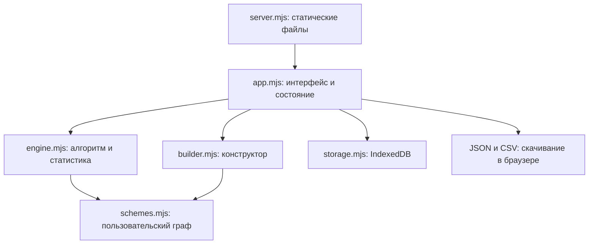

# Архитектура

## Границы

Приложение работает в браузере. Node раздаёт HTML, CSS и ESM-модули.
Сохранение выполняется через IndexedDB; сервер не получает журнал и изображения.
Нет сетевого API записи, аккаунтов, получения котировок или исполнения сделок.

## Карта модулей

| Файл | Ответственность |
| --- | --- |
| `index.html` | Точка монтирования, toast, диалог изображений, файловый input импорта |
| `styles.css` | Общие стили, журнал, редактор и адаптивная вёрстка |
| `app.mjs` | Состояние, рендер, события, автосохранение, журнал, статистика, импорт/экспорт |
| `engine.mjs` | Встроенные вопросы/переходы, адаптеры, сессии, итог, расчёты, проверка импорта, CSV |
| `schemes.mjs` | Создание схем/блоков, проверка графа, выполнение пользовательского пути |
| `builder.mjs` | Библиотека, редактор, выбор блока, автоматическая SVG-карта |
| `storage.mjs` | Открытие IndexedDB и транзакции object stores |
| `server.mjs` | Loopback HTTP, allowlist ресурсов, CSP и `/health` |
| `Start.cmd`, `Start.ps1`, `Stop.ps1` | Фоновый запуск/остановка на Windows |
| `tests/*.test.mjs` | Проверки чистой логики и обработчика удаления |

## Встроенный и пользовательский маршруты

Встроенный маршрут описан в `engine.mjs`: `question`, `route`, `answer`, `evaluation`,
`scenario`. Функция `next` задаёт переходы. Вопросы меняются в зависимости от локального направления.
Две встроенные SVG в разделе «Схемы» вручную отражают этот алгоритм.

Пользовательский маршрут исполняется по `schemeSnapshot` функциями `customRoute`,
`customAnswer`, `customEvaluation` из `schemes.mjs`. Вход — `startId`, выбранный ответ
ссылается на `next`, путь завершается блоком `result`.

Общий UI использует `routeFor(session)`, `answerFor(session, key, value)`,
`evaluationFor(session)`, `scenarioFor(session)`: наличие `schemeSnapshot` выбирает реализацию.
Прямой вызов `route(session.answers)` для пользовательского разбора неверен.

## Жизненный цикл разбора

1. `freshSession()` создаёт встроенный разбор. `freshSchemeSession(scheme)` проверяет
   схему и глубоко копирует её в разбор.
2. Ответ обновляет `answers`. Если изменён ранний вопрос, последующие ответы отбрасываются.
3. `routeFor` возвращает посещённые вопросы и следующий неотвеченный либо итог.
4. Пользователь фиксирует сделку или наблюдение без входа.
5. `lockDecision` сохраняет `decisionSnapshot`: ответы, версию, заключение и время фиксации.
6. UI блокирует вопросы, сохраняя возможность добавить фактический исход и комментарии.

Неизменяемость решения — контракт функций/UI. Объекты не защищены через `Object.freeze`
или ограничения IndexedDB; новый код должен соблюдать этот контракт.

## Состояние и сохранение

`app.mjs` хранит в памяти `sessions`, `customSchemes`, `currentId`, `cursor`, раздел,
поиск и фильтр. Навигация использует hash: `#new`, `#journal`, `#stats`, `#schemes`, `#builder`.
Текущий `currentId` сохраняется; поиск и фильтры — только в памяти страницы.
Выбранный блок сохраняется в `scheme.editorNodeId` и восстанавливается при открытии схемы.

`put(session)` обновляет память и очередь `pending` по ID, сохраняя копию объекта.
`putScheme` обновляет библиотеку и помечает её для записи целиком.
После 250 мс без нового изменения вызывается `flush()`. Promise-цепочка сериализует операции.
Явное сохранение и переходы также вызывают `flush`; при скрытии страницы используется `visibilitychange`.
Ошибка показывает уведомление и оставляет данные в памяти для экспорта.

Одна storage-операция использует транзакцию IndexedDB. Весь импорт или пачка сохранений
не являются одной общей транзакцией. Форматы и восстановление — в [DATA.md](DATA.md).

## Конструктор и версии

`createBuilder` получает из `app.mjs` функции работы с библиотекой, сохранения, удаления,
запуска, рендера, уведомлений и экранирования. Собственного соединения с IndexedDB у него нет.
Текстовые изменения обновляют модель и карту без полной перерисовки поля ввода;
структурные изменения и выбор перехода перерисовывают редактор.

`inspectScheme` отделяет блокирующие ошибки от предупреждений о недостижимых блоках.
Проверка достижимых циклов не использует рекурсию. Карта размещает блоки автоматически;
нажатие выбирает блок, ручного перетаскивания координат нет.
Порядок элементов `nodes` не задаёт порядок вопросов — его задают ссылки `next`.

У библиотеки есть явный `status`: `draft` или `ready`. `schemeStatus` обеспечивает совместимость
с прежними схемами без этого поля. Новые схемы и копии начинают как черновики; правки готовой
схемы возвращают статус `draft`. Проверка валидности сама по себе не делает схему готовой.
`Сохранить черновик` сохраняет даже незаполненный граф и ждёт успешного `persist`/`flush`
перед возвратом в список. `Сохранить готовую` и запуск требуют корректного графа.
`createBuilder` получает callback `persist` из приложения, а не пишет в IndexedDB самостоятельно.

При открытии существующей схемы готовится `revision + 1` для первой правки. Несколько
правок в том же сеансе редактора используют одну версию. Новая схема сохраняет revision 1;
после запуска следующий набор правок получает новую версию. Это не hash содержимого
и не полная история изменений библиотеки.

## Статистика

Чистые функции `statistics` и `profit` находятся в `engine.mjs`.
Встроенные сценарии в UI группируются по фону, направлению, откату/паузе и версии.
Пользовательские — по ID схемы и revision из снимка; название берётся из того же снимка.

Категория итога и результат сделки независимы: убыточная сделка может иметь `matched`,
прибыльная — `waiting`. Формулы и поля описаны в [DATA.md](DATA.md).
